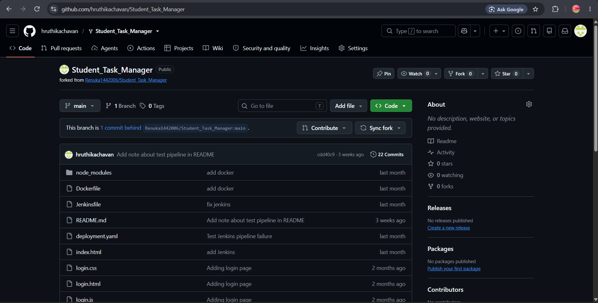
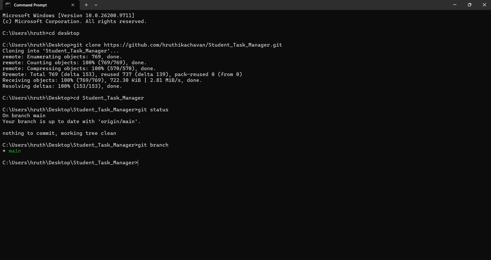
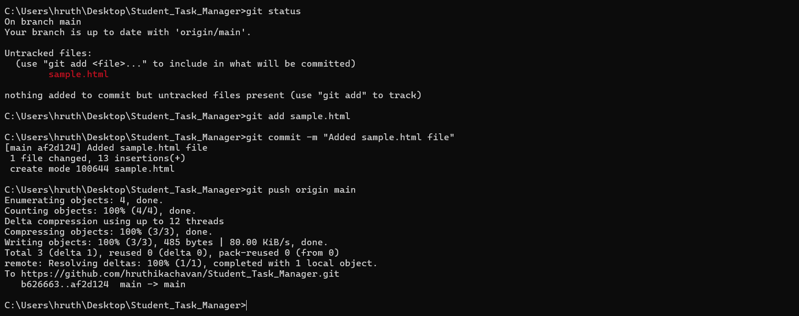
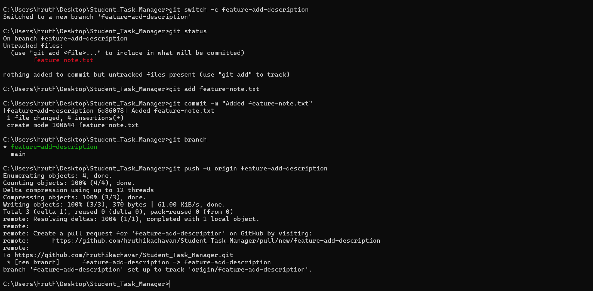
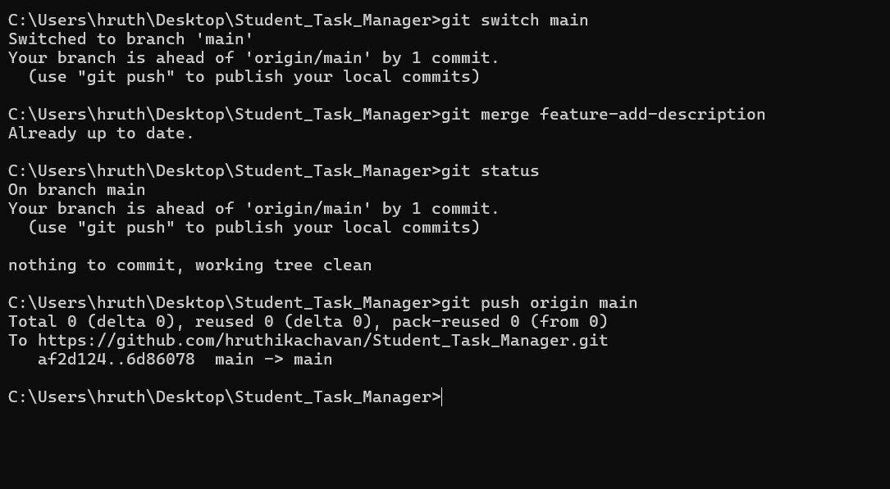
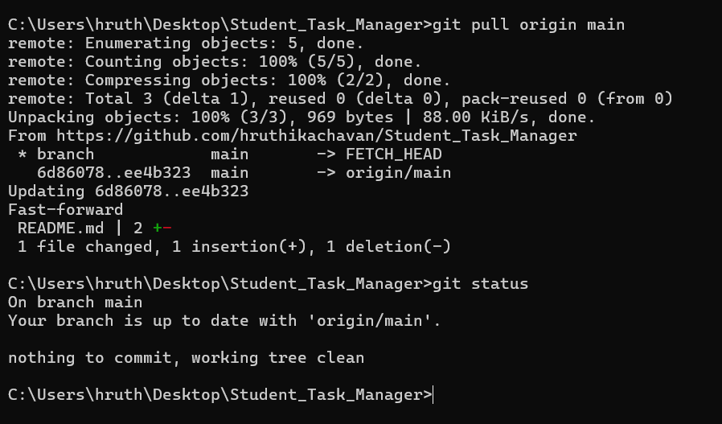
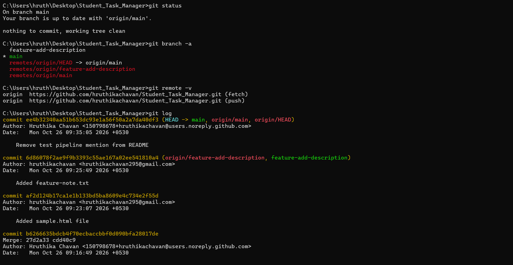
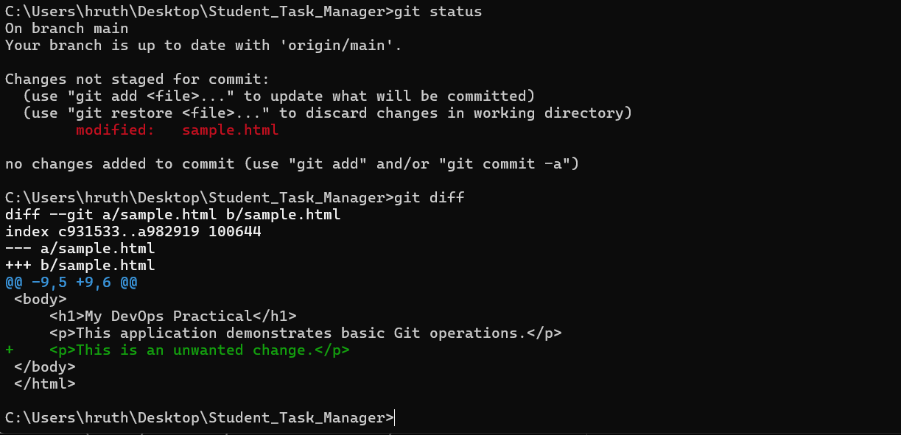
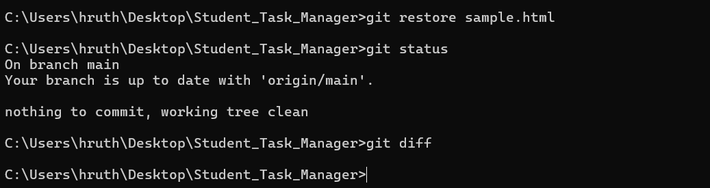

# Practical 1: Git Basics

## 🎯 Aim
To create a GitHub repository for a sample application and demonstrate basic Git operations: clone, add, commit, branch, merge, push, pull, diff, and restore.

##  Repository Details
- **Repository:** `Student_Task_Manager`
- **Repository URL:** https://github.com/hruthikachavan/Student_Task_Manager.git
- **Main branch:** `main`
- **Feature branch:** `feature-add-description`

---

## 1. Create a GitHub Repository

Created a GitHub repository to store the sample application and track changes.

## 2. Clone the Repository

Cloned the remote repository to the local machine.

**Commands:**

    git clone https://github.com/hruthikachavan/Student_Task_Manager.git
    cd Student_Task_Manager
    git status
    git branch

## 3. Create a Sample Application

Created an `sample.html` file containing a simple HTML page.

**Code (`sample.html`):**

    <!DOCTYPE html>
    <html lang="en">
    <head>
        <meta charset="UTF-8">
        <title>Git Basics Practical</title>
    </head>
    <body>
        <h1>My DevOps Practical</h1>
        
This application demonstrates basic Git operations.

    </body>
    </html>

## 4. Add, Commit, and Push Changes

Staged the application file, committed the changes, and uploaded them to GitHub.

**Commands:**

    git status
    git add sample.html
    git commit -m "Add sample HTML application"
    git push origin main

## 5. Create and Push a Feature Branch

Created a separate branch for feature development.

**Commands:**

    git switch -c feature-add-description

Created `feature-note.txt` with the following content:

    Feature Branch Demonstration

    This file was created on a separate Git branch
    to demonstrate isolated development.

Committed and pushed the feature:

    git add feature-note.txt
    git commit -m "Add feature branch demonstration"
    git branch
    git push -u origin feature-add-description

## 6. Merge the Feature Branch into Main

Switched to `main` and merged the feature branch.

**Commands:**

    git switch main
    git merge feature-add-description
    git log 
    git status
    git push origin main

## 7. Pull Changes from GitHub

Edited and committed `README.md` directly on GitHub to create a remote change. Then pulled it into the local repository.

**Commands:**

    git pull origin main
    git status

## 8. Verify Repository Status and History

**Commands:**

    git status
    git branch -a
    git remote -v
    git log 

## 9. Restore Unwanted Changes

Added a temporary paragraph to `index.html` and checked the changes.

**Before restoration:**

    git status
    git diff

Restored the file and verified the result.

**After restoration:**

    git restore index.html
    git status
    git diff

**Observation:** The unstaged changes were discarded and the working tree returned to a clean state, provided no other changes were pending.

> **Note:** `git restore index.html` discards unstaged modifications to that file. Use it only when you intend to discard those changes.

## 📋 Summary of Git Commands

| Command | Purpose |
|---|---|
| `git clone <url>` | Clones a remote repository |
| `git status` | Displays working tree status |
| `git add <file>` | Stages changes |
| `git commit -m "message"` | Records staged changes |
| `git branch` | Lists branches |
| `git switch -c <branch>` | Creates and switches to a branch |
| `git switch <branch>` | Switches branches |
| `git merge <branch>` | Merges another branch |
| `git push origin main` | Pushes commits to GitHub |
| `git pull origin main` | Retrieves and integrates remote changes |
| `git diff` | Displays unstaged changes |
| `git restore <file>` | Discards unstaged changes |
| `git log --oneline --graph --all` | Displays commit history |
| `git remote -v` | Displays remote URLs |

