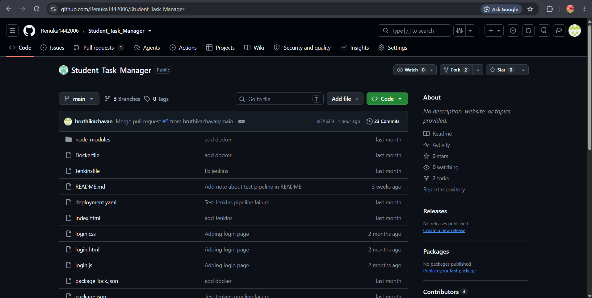
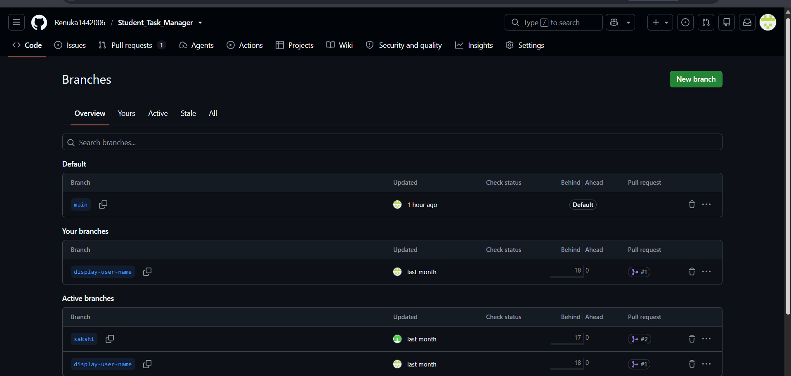
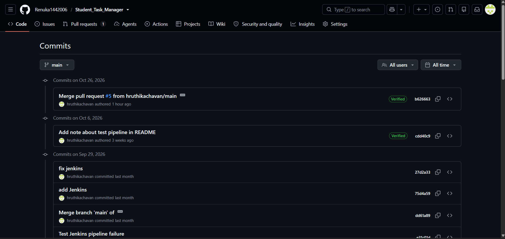
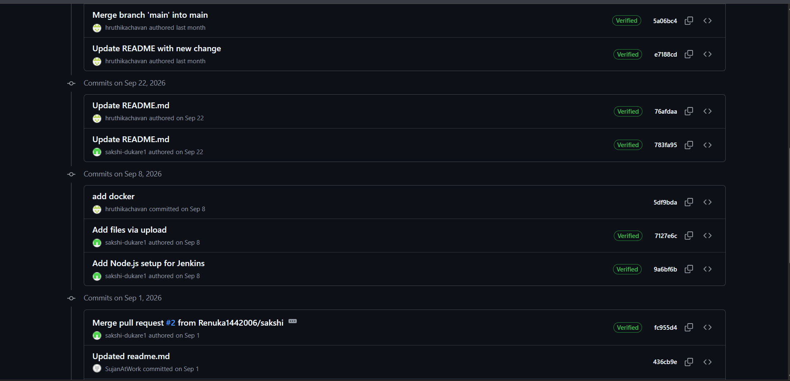
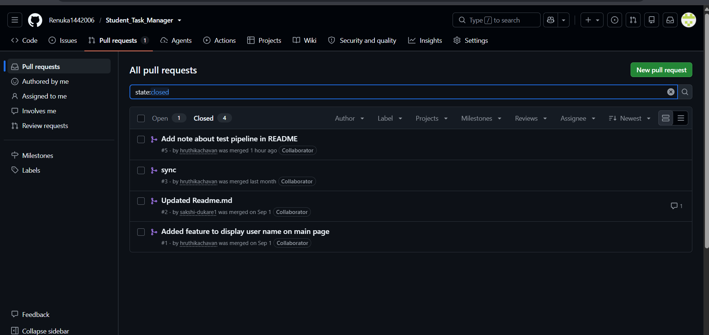
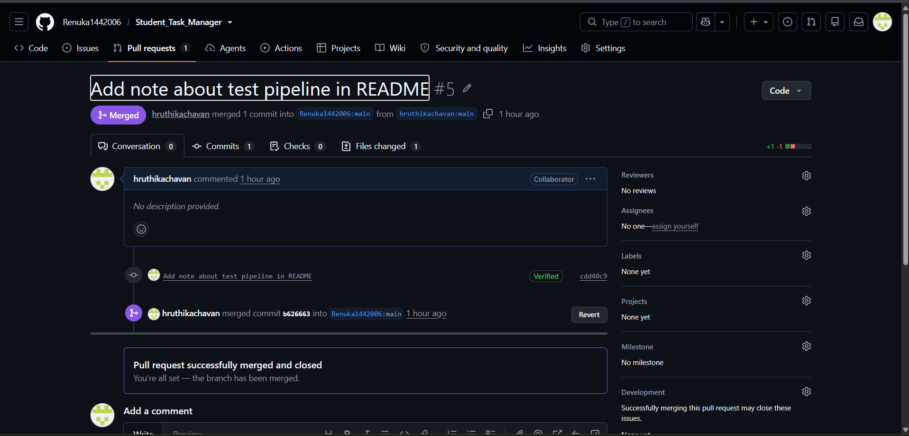

# Practical 2: Git Branching & Collaboration

## 🎯 Aim
To implement Git branching strategies using feature branches, commits, pull requests, code review, and merging to simulate collaborative development in a distributed team.

## 📌 Existing Repository Details

This practical uses a separate GitHub repository where collaborative development was performed.

- **Original Repository:** [Open Collaborative Repository](https://github.com/Renuka1442006/Student_Task_Manager.git)
- **Main Branch:** `main`
- **Feature Branch:** `display-user-name, Sakshi`
- **Pull Request:** [View Pull Request](https://github.com/Renuka1442006/Student_Task_Manager/pulls?q=is%3Apr+state%3Aclosed)

---

## 1. Repository Setup

Used an existing GitHub repository as the central repository for collaborative development.

## 2. Create a Feature Branch

Created a separate branch to develop a feature without directly modifying the main branch.

**Commands:**

    git clone https://github.com/Renuka1442006/Student_Task_Manager.git
    cd Student_Task_Manager
    git switch main
    git pull origin main
    git switch -c add-user-name

## 3. Make Changes and Push the Feature Branch

Modified the project file and committed the changes to the feature branch.

**Commands:**

    git status
    git add README.md
    git commit -m "Update project file"
    git push -u origin add-user-name

## 4. Create a Pull Request

Opened GitHub and created a pull request to propose merging the feature branch into the main branch.

**Procedure:**
1. Opened the repository on GitHub.
2. Selected the feature branch.
3. Created a pull request with `main` as the base branch.
4. Added a title and description explaining the changes.

**Evidence:**

## 5. Merge the Pull Request

Merged the pull request after reviewing the changes and verified that the updates appeared in the main branch.

**Commands for local verification:**

    git switch main
    git pull origin main

**Evidence:**

---

## 📋 Git Commands Summary

| Command | Purpose |
|---|---|
| `git clone <url>` | Clones the repository |
| `git switch main` | Switches to the main branch |
| `git pull origin main` | Retrieves the latest main branch changes |
| `git switch -c <branch>` | Creates and switches to a feature branch |
| `git status` | Displays the working tree status |
| `git add <file>` | Stages changes |
| `git commit -m "message"` | Records changes |
| `git push -u origin <branch>` | Pushes a branch to GitHub |
| `git log --oneline --graph --all` | Displays the commit history |

---
