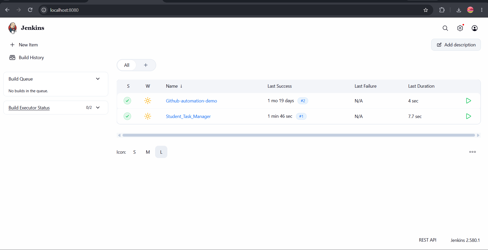
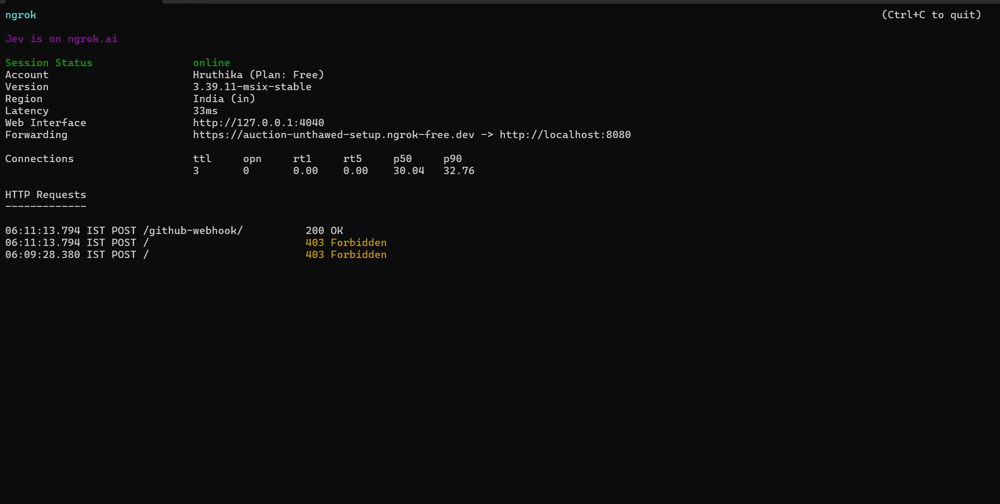
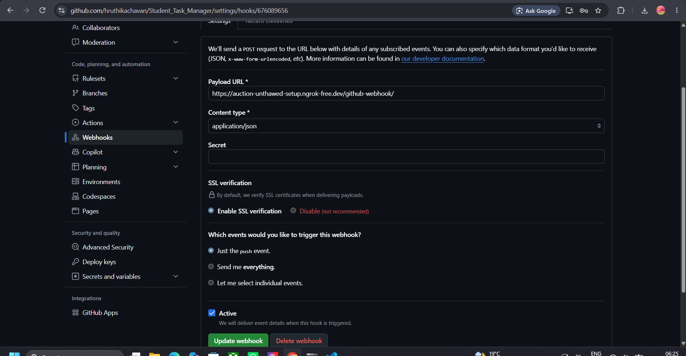
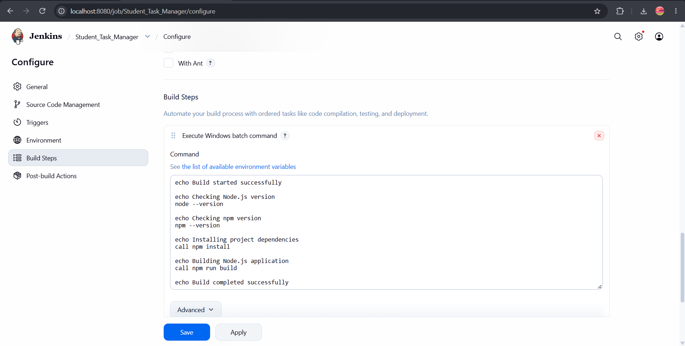
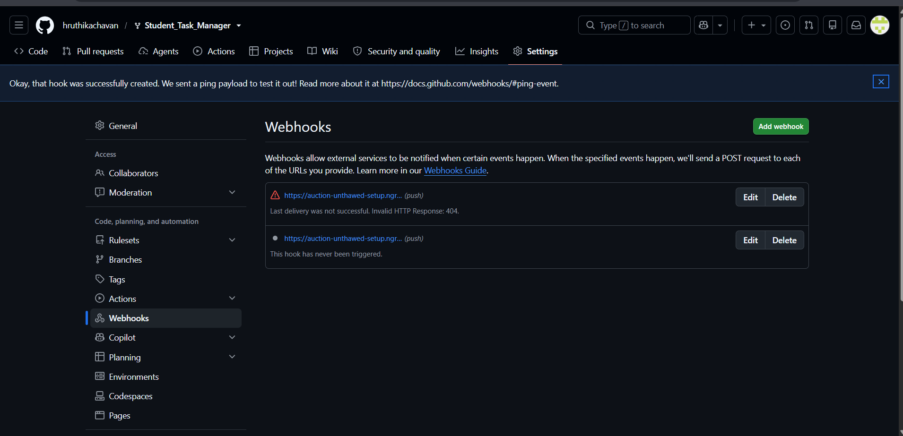
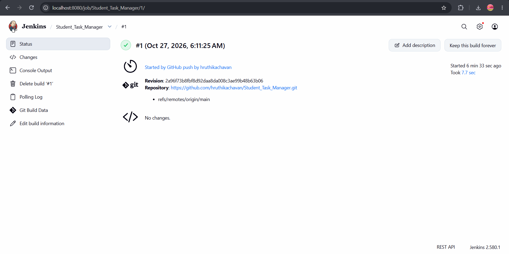
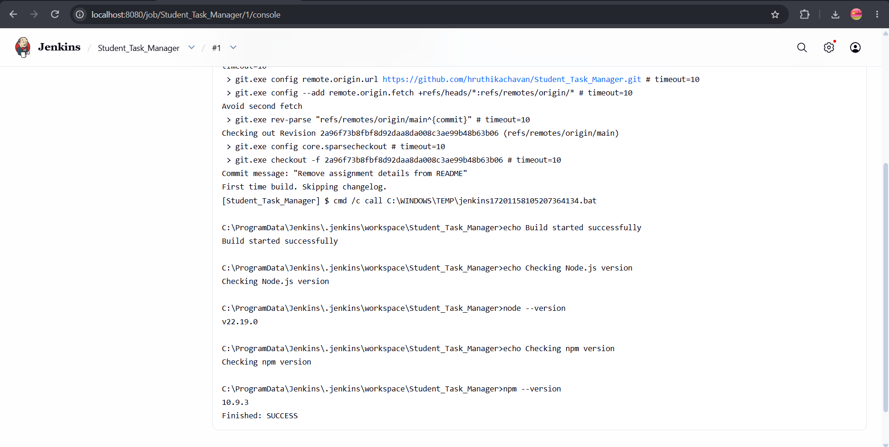

# Practical 3: Jenkins Build with GitHub Webhook and ngrok

##  Aim

To install and configure Jenkins, connect it to a GitHub repository containing a Node.js application, and automate builds using GitHub webhooks and ngrok.

##  Tools and Technologies

- Jenkins LTS
- Git and GitHub
- Node.js
- npm
- ngrok
- Windows
- Jenkins Freestyle Project

## ⚙️ Implementation

### 1. Install and Configure Jenkins

Installed Jenkins on Windows using the official Windows installer.

**Steps performed:**

1. Installed a supported Java Development Kit (JDK).
2. Installed Jenkins LTS.
3. Completed the initial administrator setup.
4. Installed the suggested plugins.
5. Opened the Jenkins dashboard at `http://localhost:8080`.

**Screenshot:**

### 2. Create a Jenkins Freestyle Job

Created a Freestyle project named `GitHub-Auto-Build`.

**Configuration:**

- **Job Name:** `Student_Task_Manager`
- **Source Code Management:** Git
- **Repository URL:** `https://github.com/hruthikachavan/Student_Task_Manager.git`
- **Branch Specifier:** `*/main`
- **Build Trigger:** GitHub hook trigger for GITScm polling

**Screenshot:**

### 3. Configure ngrok

Used ngrok to expose the locally running Jenkins server through a public HTTPS endpoint so GitHub could deliver webhook notifications.

**Commands:**

    ngrok config add-authtoken ""
    ngrok http 8080

ngrok provided a public HTTPS forwarding URL that forwarded requests to the local Jenkins server.

**Webhook URL: **

     https://auction-unthawed-setup.ngrok-free.dev/github-webhook

**Screenshot:**

>

### 4. Configure the GitHub Webhook

Configured a webhook in the GitHub repository to notify Jenkins when changes were pushed.

**Configuration:**

- **Payload URL:**  https://auction-unthawed-setup.ngrok-free.dev/github-webhook
- **Content Type:** `application/json`
- **Event:** Push events
- **Active:** Enabled

The webhook forwards GitHub push notifications to Jenkins through the ngrok tunnel.

**Screenshot:**

### 5. Configure the Node.js Build

Configured the Jenkins job to retrieve the Node.js application from GitHub and execute the required build commands.

** Windows batch commands:**

    echo Build started successfully
    node --version
    npm --version
    call npm install
    call npm run build
    echo Build completed successfully

**Screenshot:**

### 6. Verify GitHub Webhook Delivery

Made a change to the GitHub repository and committed it to the `main` branch.

Opened the repository's **Settings → Webhooks → Recent Deliveries** section to inspect the push event and its response.

**Screenshot:**

### 7. Verify Automatic Jenkins Build

After pushing the change to GitHub, verified that Jenkins automatically started a new build without manually clicking **Build Now**.

Opened the corresponding build number and inspected its Console Output.

**Expected evidence:**

- Git checkout from the configured repository
- Node.js and npm version output
- Dependency installation and build output
- Successful build completion

**Screenshot:**

---

##  Important Concepts

| Concept | Description |
|---|---|
| Jenkins | Automation server for software development workflows |
| Freestyle Project | A Jenkins job configured through the graphical interface |
| GitHub Webhook | Sends notifications when repository events occur |
| ngrok | Exposes a local service through a public tunnel |
| Git Plugin | Enables Jenkins to retrieve source code from Git repositories |
| GitHub Plugin | Supports GitHub integration and webhook-triggered jobs |
| npm | Node.js package manager |
| Build Trigger | Starts a Jenkins job when the configured event occurs |
| Console Output | Displays checkout logs and build execution results |

