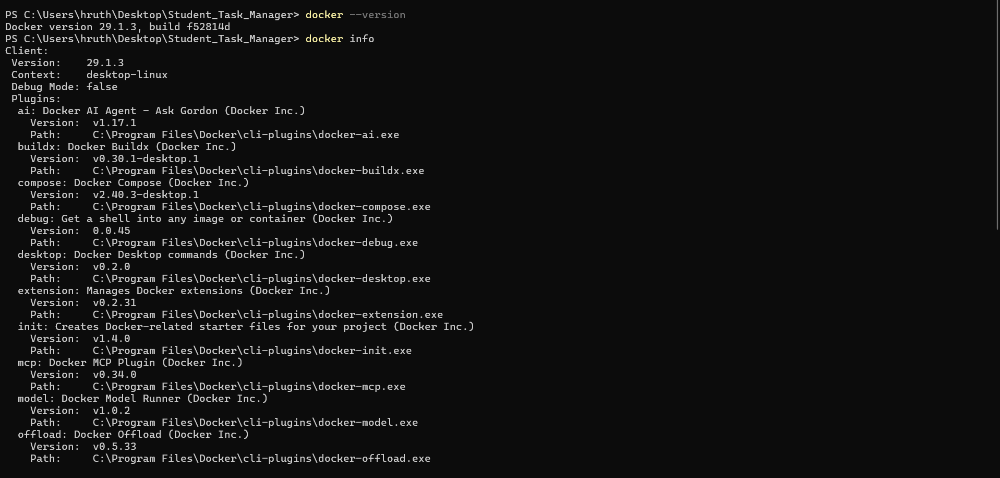
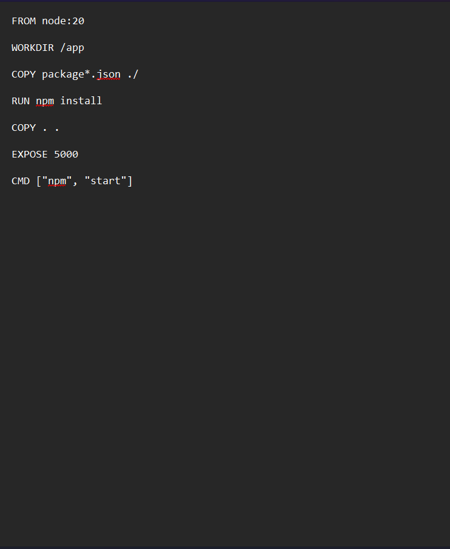
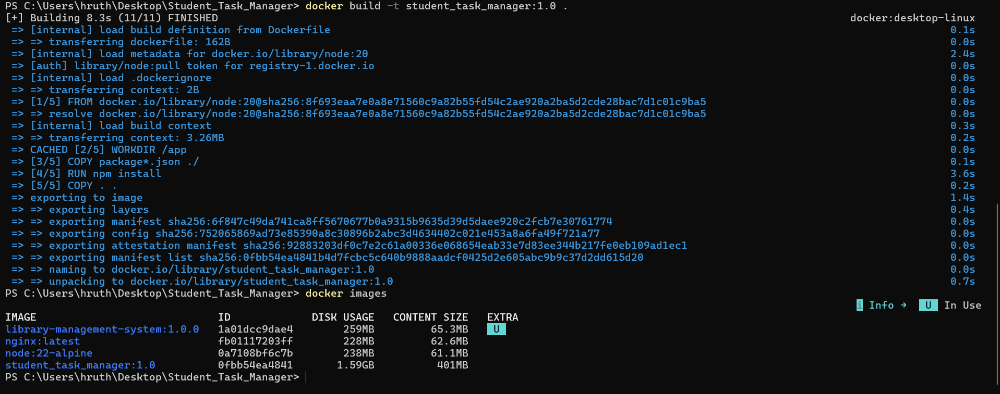
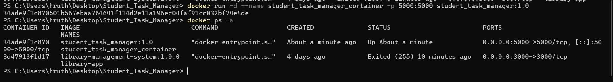
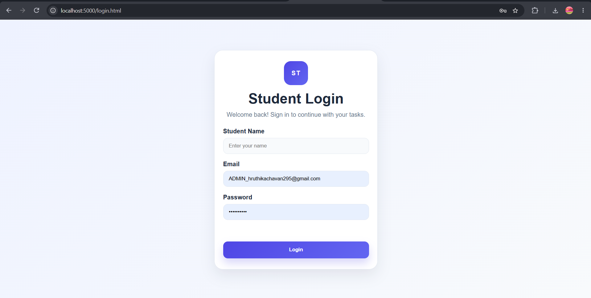

# Practical 4: Dockerization of a Node.js Application

##  Aim

To containerize a Node.js application using Docker so that it can run consistently across different environments without requiring manual dependency installation on the host machine.

##  Tools and Technologies

- Docker Desktop
- Docker CLI
- Node.js
- npm
- Visual Studio Code
- GitHub

##  Procedure

### 1. Verify Docker Installation

Verified Docker installation and confirmed that the Docker Engine was running.

**Commands:**

    docker --version
    docker info

**Evidence:**

### 2. Create the Dockerfile

Created a `Dockerfile` in the root directory of the Node.js application.

**Example Dockerfile:**

    FROM node:22-alpine
    WORKDIR /app
    COPY package*.json ./
    RUN npm install
    COPY . .
    EXPOSE 5000
    CMD ["npm", "start"]

The Dockerfile defines the base image, working directory, dependency installation, application files, exposed port, and startup command.

The example assumes the application supports `npm start` and listens on port 3000. The actual Dockerfile should match the project's Node.js version, startup script, and port.

Created a `.dockerignore` file to exclude unnecessary files such as `node_modules`, `.git`, and `.env`.

**Evidence:**

### 3. Build the Docker Image

Built a Docker image from the application source code and Dockerfile.

**Commands:**

    docker build -t student_task_manager:1.0 .
    docker images

**Explanation:**

- `docker build` builds the image.
- `-t` assigns a name and tag.
- `.` specifies the current directory as the build context.
- `docker images` lists the locally available images.

**Evidence:**

### 4. Run the Docker Container

Created and started a container from the built image.

**Command:**

    docker run -d --name student_task_manager_container -p 5000:5000 student_task_manager:1.0

**Explanation:**

- `-d` runs the container in the background.
- `--name` assigns a container name.
- `-p 5000:5000` maps host port 3000 to container port 3000.
- `student_task_manager:1.0` specifies the image.

**Verification:**

    docker ps

**Evidence:**

### 5. Access the Application 

Opened the browser and accessed the application through the published port.

**URL:**

    http://localhost:5000

**Evidence:**

The application should display its actual page or API response. The port must match the application configuration.

### 7. Manage the Container

Used Docker commands to stop and restart the container when required.

**Commands:**

    docker stop student_task_managera_container
    docker start student_task_managera_container

**Additional verification:**

    docker ps
    docker logs student_task_managera_container

---

##  Summary of Docker Commands

| Command | Purpose |
|---|---|
| `docker --version` | Displays the installed Docker version |
| `docker info` | Displays Docker Engine information |
| `docker build -t name:tag .` | Builds an image |
| `docker images` | Lists Docker images |
| `docker run -d --name name -p host:container image` | Creates and starts a container |
| `docker ps` | Lists running containers |
| `docker logs <container>` | Displays container logs |
| `docker stop <container>` | Stops a running container |
| `docker start <container>` | Starts a stopped container |
| `docker rm <container>` | Removes a stopped container |

