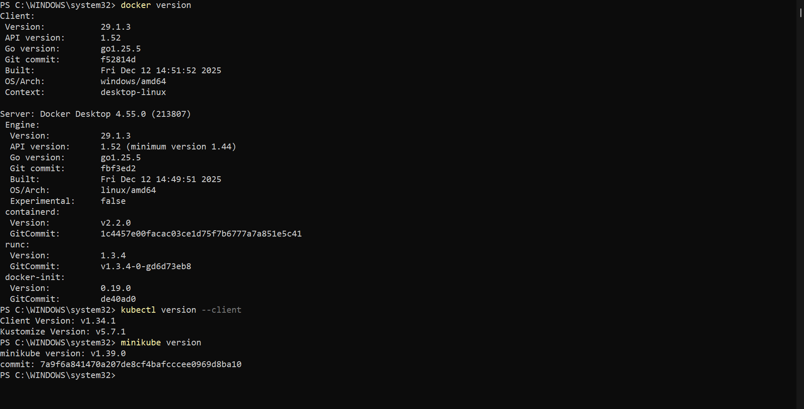
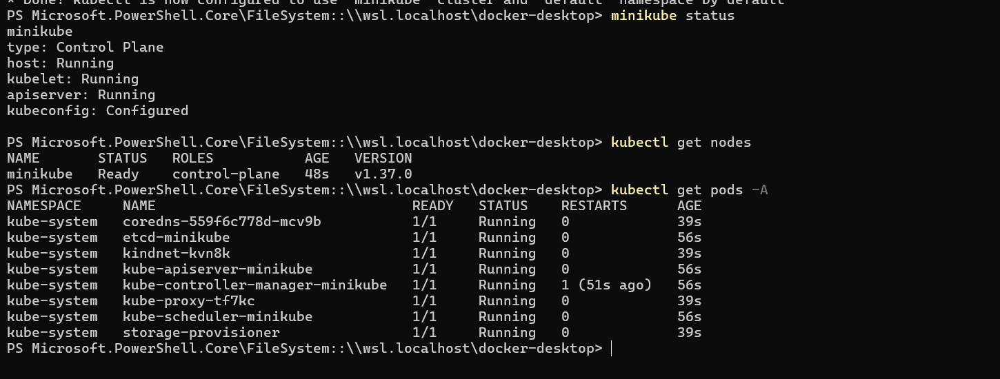
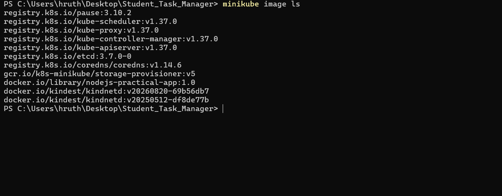
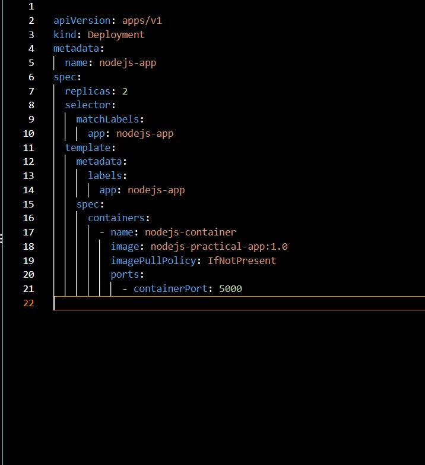
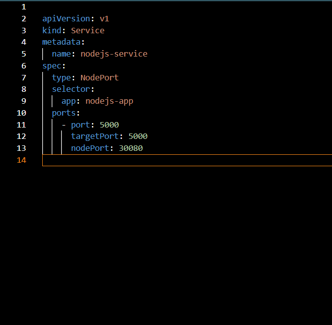
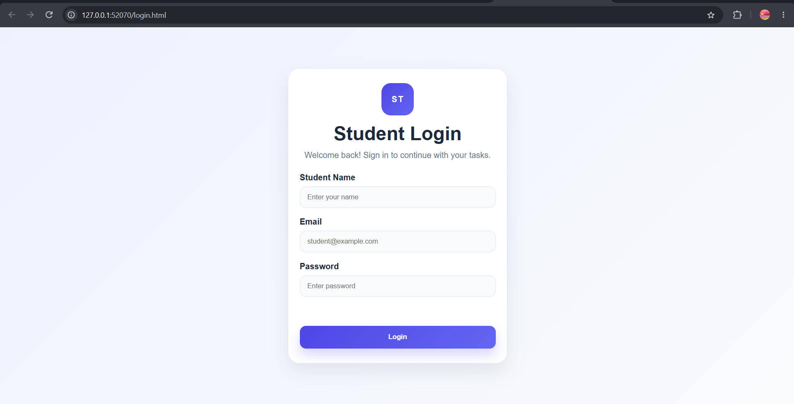
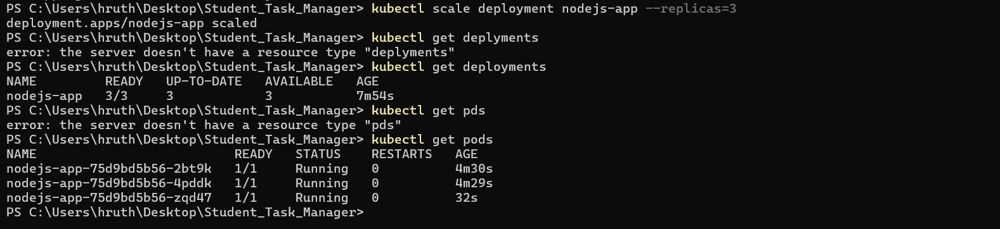

# Practical 5: Kubernetes Deployment and Scaling

## Aim
To deploy a containerized Node.js application using Kubernetes,
expose it through a Service, and demonstrate horizontal scaling.

## Tools Used
- Docker Desktop
- Minikube
- kubectl
- Kubernetes
- Node.js

## Procedure
1. Started the Minikube Kubernetes cluster.
2. Built the Node.js image for Minikube.
3. Created a Deployment with two replicas.
4. Exposed the application using a NodePort Service.
5. Verified the Deployment, Pods, and Service.
6. Accessed the application in a browser.
7. Scaled the Deployment to three replicas.

## Commands Used

    minikube start --driver=docker
    kubectl get nodes
    minikube image build -t nodejs-practical-app:1.0 .
    kubectl apply -f deployment.yaml
    kubectl apply -f service.yaml
    kubectl get deployments
    kubectl get pods
    kubectl get services
    minikube service nodejs-service
    kubectl scale deployment nodejs-app --replicas=3

## Screenshots

### 1. Installed versions

### 2. Kubernetes Cluster

### 3. Application Image

### 4. Deployment Configuration

### 5. Service Configuration

### 6. Deployment Status

### 7. Application in Browser

### 8. Scaling to Three Replicas

