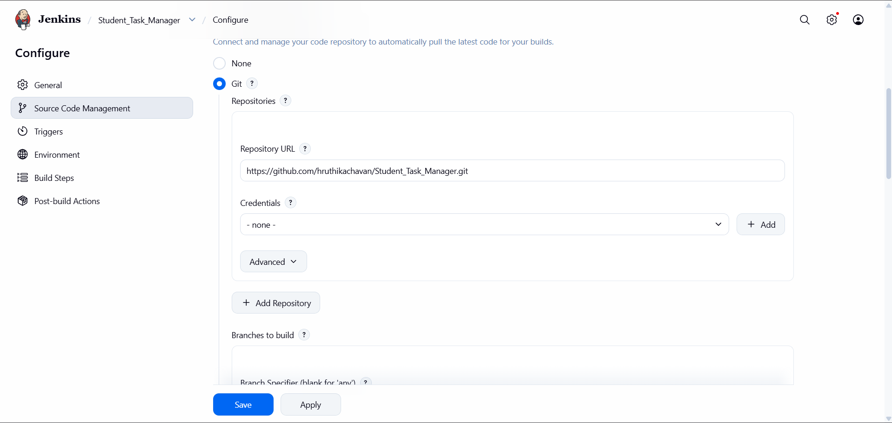
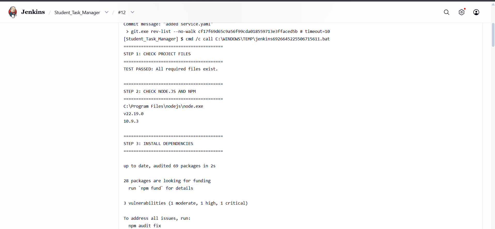
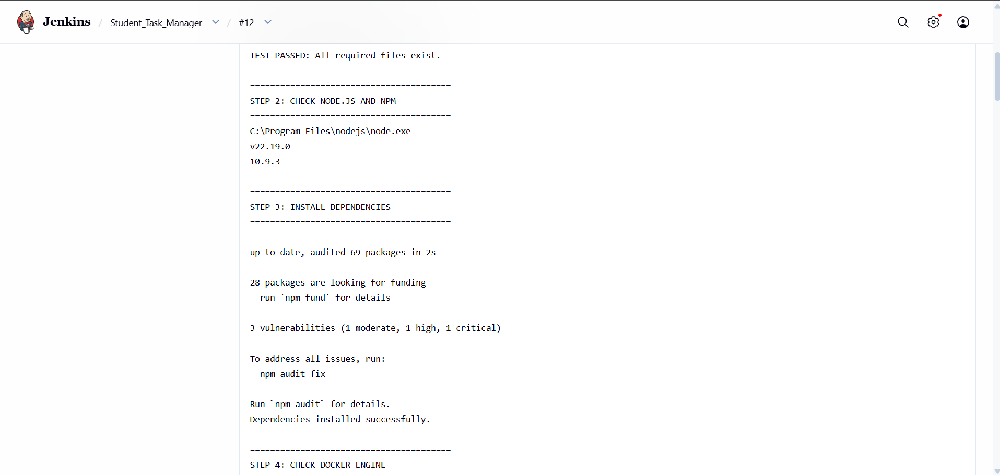
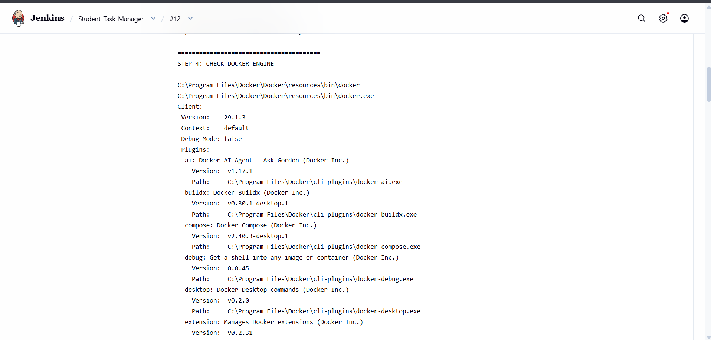
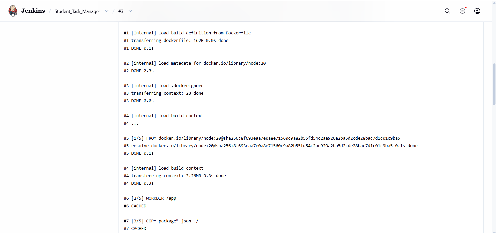
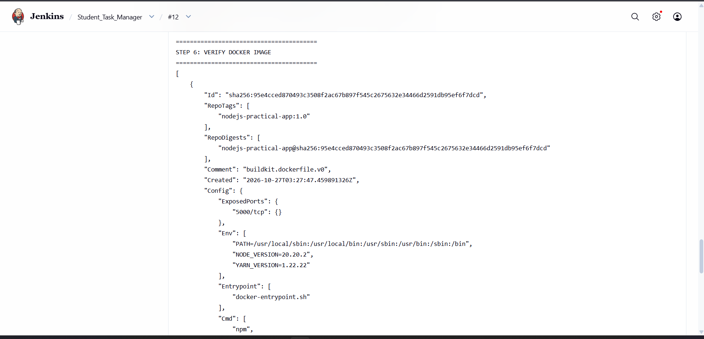
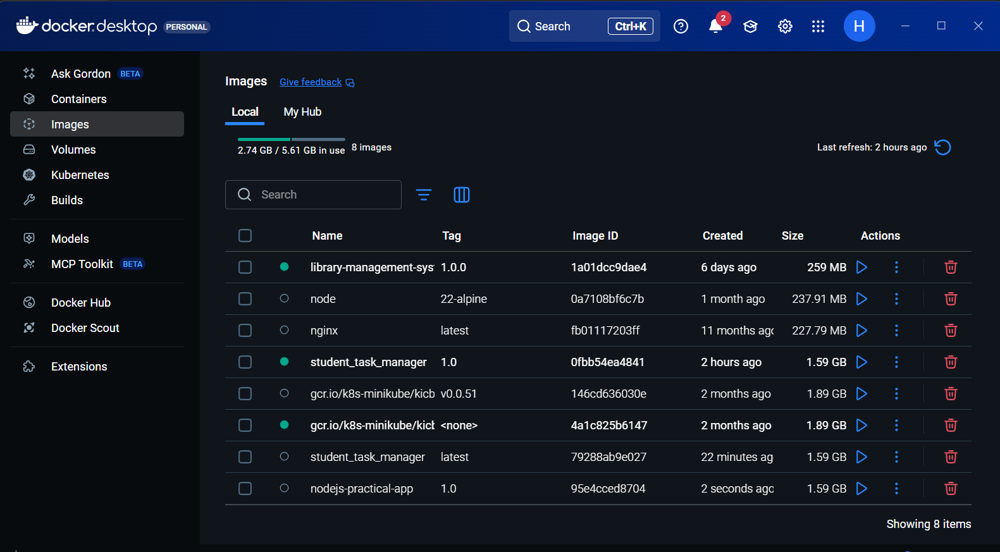
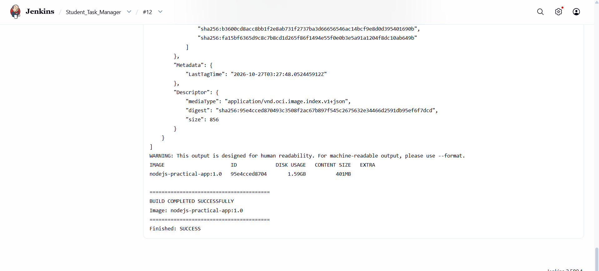

# Practical 6: CI/CD Pipeline Using Jenkins and Docker

## Aim

To configure an existing Jenkins Freestyle project to automate project file validation, Node.js dependency installation, and Docker image creation, and to verify the generated image using Docker Desktop.

## Tools and Technologies

- Jenkins LTS
- Git and GitHub
- Node.js
- npm
- Docker Desktop
- Docker Engine
- Windows
- Jenkins Freestyle Project

---

##  Implementation

### 1. Configure the Existing Jenkins Job

Used the existing Jenkins Freestyle project named `Student_Task_Manager` to automate the build process for the Node.js application.

**Configuration:**

- **Job Name:** `Student_Task_Manager`
- **Source Code Management:** Git
- **Repository URL:** `https://github.com/hruthikachavan/Student_Task_Manager.git`
- **Branch Specifier:** `*/main`
- **Build Step:** Execute Windows batch command

**Steps performed:**

1. Opened the Jenkins dashboard.
2. Selected the existing `Student_Task_Manager` job.
3. Opened the job configuration.
4. Verified the Git repository URL and branch.
5. Configured the Windows batch script under Build Steps.

**Screenshot:**



---

### 2. Validate Required Project Files

Added a file-validation step to verify that important application files exist before starting the build.

**Files checked:**

- `package.json`
- `Dockerfile`
- `server.js`
- `index.html`
- `test.js`

**Sample Windows batch commands:**

```bat
if not exist package.json (
    echo TEST FAILED: package.json is missing
    exit /b 1
)

if not exist Dockerfile (
    echo TEST FAILED: Dockerfile is missing
    exit /b 1
)

if not exist server.js (
    echo TEST FAILED: server.js is missing
    exit /b 1
)

if not exist index.html (
    echo TEST FAILED: index.html is missing
    exit /b 1
)

if not exist test.js (
    echo TEST FAILED: test.js is missing
    exit /b 1
)

echo TEST PASSED: All required files exist.
```

If any required file is missing, the script exits with an error and Jenkins marks the build as failed.

This step performs file-existence testing; it does not execute `test.js` or verify application functionality.

**Screenshot:**



---

### 3. Check Node.js and npm

Verified that Node.js and npm are installed and accessible to the Jenkins service account.

**Commands:**

```bat
where node
node --version
call npm --version
```

These commands confirm that the required tools are available before dependency installation.

**Screenshot:**



---

### 4. Install Node.js Dependencies

Configured Jenkins to install the application dependencies using npm.

**Windows batch command:**

```bat
call npm install
if errorlevel 1 exit /b 1
```

**Explanation:**

- `npm install` installs dependencies listed in `package.json`.
- `if errorlevel 1 exit /b 1` stops the build if dependency installation fails.

**Screenshot:**


---

### 5. Check Docker Engine Availability

Verified that Docker is available and that Jenkins can communicate with the Docker Engine.

**Commands:**

```bat
where docker
docker info
```

Docker Desktop must be running, and the Jenkins service account must have permission to access the same Docker Engine used by Docker Desktop.

If Docker is unavailable, the build stops before attempting to create the image.

**Screenshot:**



---

### 6. Build the Docker Image

Configured Jenkins to build a Docker image from the application's Dockerfile.

**Windows batch command:**

```bat
docker build --progress=plain -t nodejs-practical-app:1.0 .
if errorlevel 1 exit /b 1
```

**Command explanation:**

- `docker build` builds an image using the Dockerfile.
- `--progress=plain` displays detailed build output.
- `-t nodejs-practical-app:1.0` assigns the image name and tag.
- `.` specifies the current Jenkins workspace as the build context.

During the build, Docker executes the instructions defined in the Dockerfile, including installing application dependencies if the Dockerfile contains the appropriate npm command.

**Screenshot:**



---

### 7. Verify the Docker Image

After building the image, verified that it was successfully created in the Docker Engine.

**Commands:**

```bat
docker image inspect nodejs-practical-app:1.0
if errorlevel 1 exit /b 1

docker images nodejs-practical-app
```

The inspection command confirms that Docker can find the generated image. The image-list command displays its repository name, tag, image ID, and size.

**Expected image:**

- **Repository:** `nodejs-practical-app`
- **Tag:** `1.0`

**Screenshot:**



---

### 8. Verify the Image in Docker Desktop

Opened Docker Desktop and navigated to the **Images** section to confirm that the generated image was available.

**Steps performed:**

1. Opened Docker Desktop.
2. Selected **Images**.
3. Located `nodejs-practical-app`.
4. Verified the tag `1.0`.

The image should appear in Docker Desktop when Jenkins and Docker Desktop use the same Docker Engine.

**Screenshot:**



---

### 9. Verify the Jenkins Build Result

Executed the configured Jenkins job using **Build Now** and inspected the Console Output.

**Successful build evidence:**

- Required project files passed validation.
- Node.js and npm were available.
- Dependencies were installed successfully.
- Docker Engine was accessible.
- Docker image creation completed successfully.
- Image inspection and verification succeeded.

**Steps performed:**

1. Saved the Jenkins job configuration.
2. Clicked **Build Now**.
3. Opened the latest build.
4. Selected **Console Output**.
5. Verified that the build completed without errors.

**Screenshots:**



---

## Build Workflow

```text
Developer pushes code to GitHub
              |
              v
       Jenkins checks out code
              |
              v
       Validate required files
              |
              v
       Check Node.js and npm
              |
              v
       Install npm dependencies
              |
              v
       Check Docker Engine
              |
              v
       Build Docker image
              |
              v
       Verify Docker image
              |
              v
       View image in Docker Desktop
```

A GitHub push starts the workflow automatically only if the repository webhook and Jenkins build trigger are configured correctly.

---

## Important Concepts

| Concept | Description |
|---|---|
| Jenkins | Automation server used to run software build workflows |
| Freestyle Project | A Jenkins job configured through the graphical interface |
| GitHub Webhook | Notifies Jenkins about repository events when configured |
| Node.js | Runtime used to execute JavaScript outside the browser |
| npm | Package manager used to install Node.js dependencies |
| Dockerfile | Contains instructions for building a Docker image |
| Docker Image | Packaged application environment used to create containers |
| Docker Engine | Builds and manages Docker images and containers |
| Docker Desktop | Provides a desktop interface for Docker resources |
| Build Context | Files and directories made available to the Docker build |
| Console Output | Displays logs produced during Jenkins build execution |
| File Validation | Checks whether required files exist before building |

---


