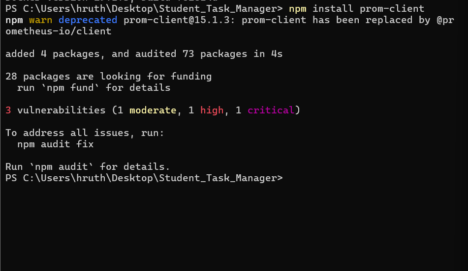
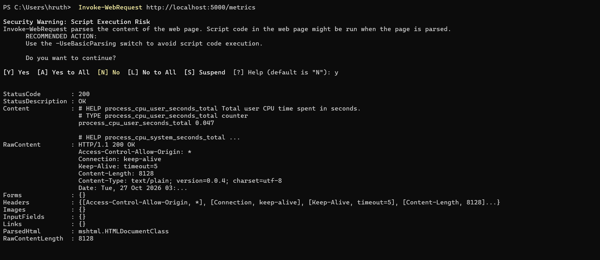
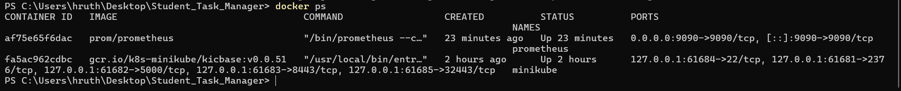
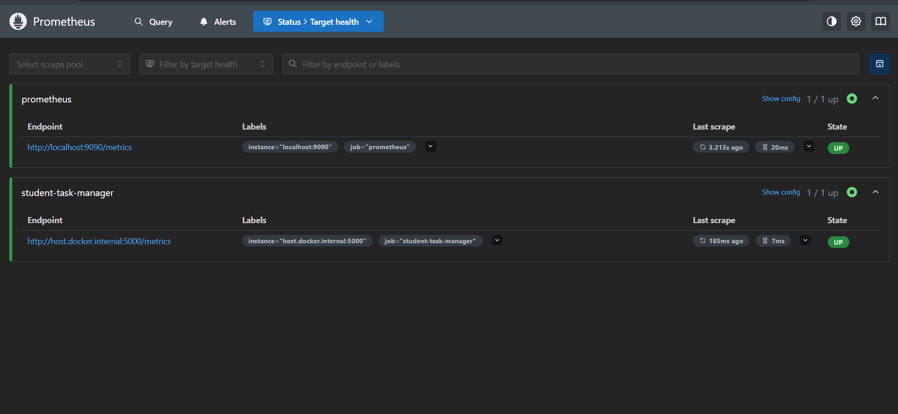
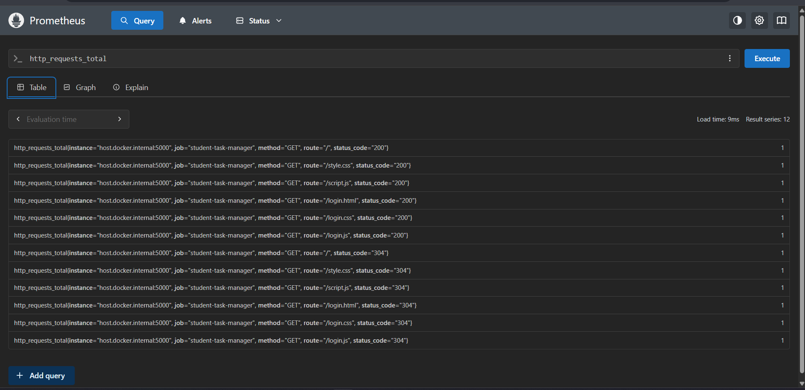
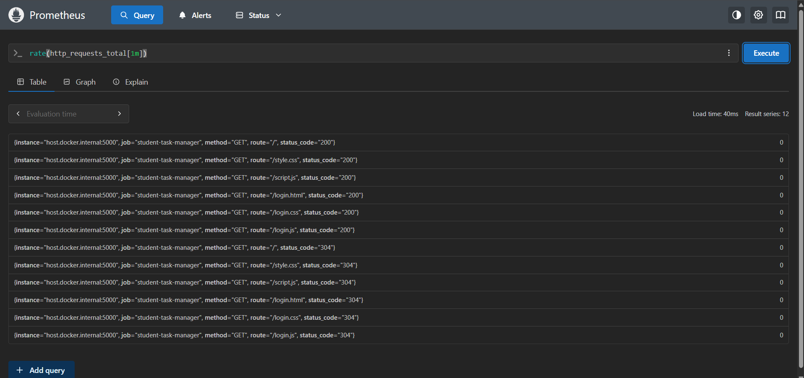
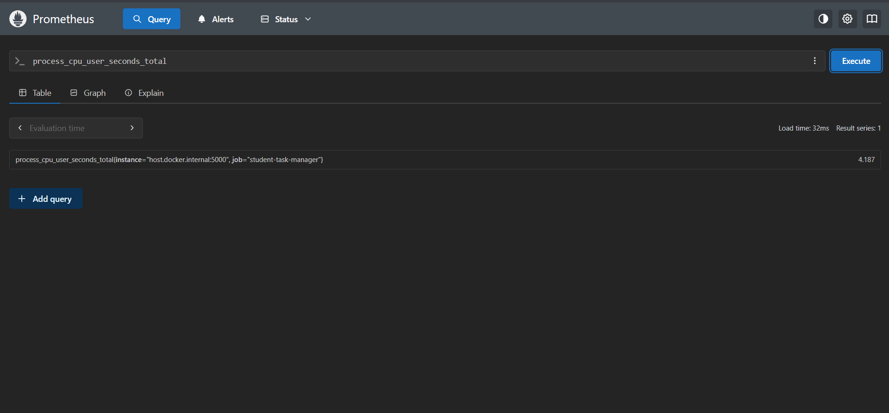

# Practical 8: Prometheus Monitoring

## Aim
To monitor the Student Task Manager Node.js application using Prometheus and collect application and system metrics.

## Technologies Used
- Node.js
- Express.js
- Prometheus
- Docker Desktop
- prom-client
- Windows PowerShell

## Step 1: Check Prerequisites

Run these commands in PowerShell:

    node --version
    npm --version
    docker --version
    docker info

## Step 2: Install Prometheus Client

Navigate to the project directory:

    cd C:\Users\hruth\Desktop\Student_Task_Manager

Install the package:

    npm install prom-client

The `prom-client` library allows Node.js applications to expose metrics in Prometheus format.

## Step 3: Configure Application Metrics

Update `server.js` to import `prom-client` and expose a `/metrics` endpoint.

The application should provide:
- `http_requests_total` — total HTTP requests.
- `http_request_duration_seconds` — HTTP request duration.
- Default Node.js process metrics, including CPU and memory-related metrics.

Start the application:

    node server.js

Open the following URL:

    http://localhost:5000/metrics

Alternatively, test it using PowerShell:

    Invoke-WebRequest http://localhost:5000/metrics

A response with status code `200 OK` confirms that the metrics endpoint is responding.

## Step 4: Configure Prometheus

Create the directory `monitoring` and create `prometheus.yml` inside it.

Add the following configuration:

    global:
      scrape_interval: 5s
      evaluation_interval: 5s

    scrape_configs:
      - job_name: "prometheus"
        static_configs:
          - targets: ["localhost:9090"]

      - job_name: "student-task-manager"
        metrics_path: /metrics
        static_configs:
          - targets: ["host.docker.internal:5000"]

Explanation:
- `scrape_interval: 5s` collects metrics every five seconds.
- `prometheus` monitors Prometheus itself.
- `student-task-manager` monitors the Node.js application.
- `/metrics` is the application metrics endpoint.
- `host.docker.internal:5000` allows the Prometheus container to access the application running on Windows.

## Step 5: Run Prometheus Using Docker

Make sure the file exists at:

    C:\Users\hruth\Desktop\Student_Task_Manager\monitoring\prometheus.yml

Run these commands from the project directory in PowerShell:

    docker rm -f prometheus
    docker run -d --name prometheus -p 9090:9090 prom/prometheus
    docker cp .\monitoring\prometheus.yml prometheus:/etc/prometheus/prometheus.yml
    docker restart prometheus

Verify that the container is running:

    docker ps --filter "name=prometheus"

Note: The configuration is copied into the container. If you edit the local file later, copy it into the container again and restart Prometheus.

## Step 6: Verify Prometheus Targets

Open the Prometheus dashboard:

http://localhost:9090

Navigate to Status > Targets, or open:

http://localhost:9090/targets

Check these targets:
- `prometheus`
- `student-task-manager`

Both should display `UP`.

Keep the Node.js application running on port 5000. If the application target shows `DOWN`, verify that `http://localhost:5000/metrics` is accessible and inspect the target's error message.

## Step 7: Execute Prometheus Queries

Open:

http://localhost:9090/graph

### Query 1: Total HTTP Requests

    http_requests_total

This displays the HTTP requests recorded by the application.

### Query 2: HTTP Request Rate

    rate(http_requests_total[1m])

This calculates the approximate per-second request rate over the previous minute. Enough samples must be available.

### Query 3: Node.js CPU Metric

    process_cpu_user_seconds_total

This displays cumulative CPU time spent executing user code by the Node.js process.

