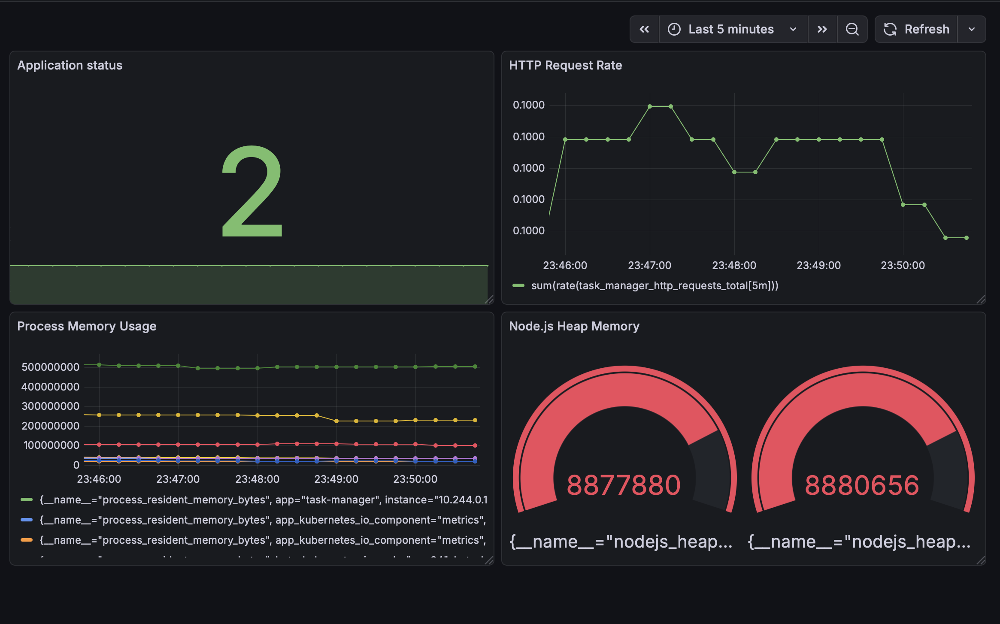
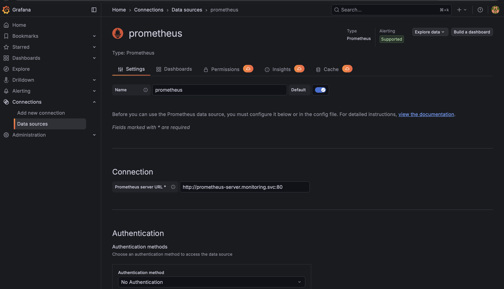

# Practical 9: Visualization with Grafana

## Aim

To create Grafana dashboards to visualize and analyze real-time application metrics collected by Prometheus for the Student Task Manager application.

## Tools and Technologies

- Grafana
- Prometheus
- Docker Desktop
- Docker Engine
- Node.js
- Express.js
- prom-client
- PromQL
- Windows PowerShell

---

## Implementation

### 1. Run Grafana Using Docker

Started Grafana using Docker to visualize the metrics collected by Prometheus.

**Command:**

powershell
docker run -d --name grafana -p 3000:3000 -v grafana-storage:/var/lib/grafana grafana/grafana
**Screenshots:**

